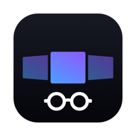

<p align="center"></p>
<h1 align="center">XRealDesk</h1>
<p align="center"><strong>Up to eight Mac displays in your XREAL Air glasses.</strong></p>
<p align="center"><a href="https://github.com/PlunderStruck/XRealDesk/releases/download/v1.0.0/XRealDesk-1.0.0-macOS.zip"><strong>Download XRealDesk 1.0 for macOS ↓</strong></a> &nbsp; · &nbsp; <a href="#install">Install guide</a> &nbsp; · &nbsp; <a href="#keyboard-shortcuts">Keyboard shortcuts</a></p>

Drag a window above your Mac screen and it appears in your glasses. Arrange your displays in a curve, turn your head to look along the row, and press **Control + Option + R** to bring the workspace back in front of you.

| What you need | Compatibility |
| --- | --- |
| Mac | macOS 14 or later, Apple silicon or Intel with Metal graphics |
| Glasses | XREAL Air, Air 2, Air 2 Pro (tested), or Air 2 Ultra. The One and One Pro use a different protocol and are unsupported. |
| Connection | A USB-C port and cable that carry video |

## Install

1. **[Download XRealDesk for macOS](https://github.com/PlunderStruck/XRealDesk/releases/download/v1.0.0/XRealDesk-1.0.0-macOS.zip)**, double-click the ZIP, and drag **XRealDesk.app** into **Applications**.
2. Open **XRealDesk** from Applications. This community build has no Apple Developer ID or Apple notarization, so macOS may block the first launch.
3. If macOS says it cannot verify the developer and you trust the ZIP you downloaded from this project's release, open **Terminal** and run the commands below. The first removes the download quarantine marker from this app. The second opens it.

   ```sh
   xattr -d com.apple.quarantine /Applications/XRealDesk.app
   open /Applications/XRealDesk.app
   ```

4. Plug in the glasses and follow the setup assistant. Grant **Screen Recording** so XRealDesk can draw your Mac windows in the glasses. **Accessibility** is optional and lets XRealDesk restore window positions and focus the window you look at.

## Your first workspace

- **Move a window into the glasses.** By default, the virtual displays sit above your Mac screen. Drag a window through the top edge. To change the crossing edge, open **Settings → Screens**.
- **Choose a layout.** Click the glasses icon in the menu bar or press **Control + Option + X**. Pick a single wide display, a row of screens, or a grid. Click a screen in the 3D view to bring it in front of you.
- **Recenter.** Look straight ahead and press **Control + Option + R**. Reopen the setup assistant from the wand in the control panel to adjust alignment.
- **Disconnect.** When you quit or unplug the glasses, macOS moves the windows back to your Mac. XRealDesk restores mirroring when it quits.

### How the screens move

| Mode | What you see when you turn your head |
| --- | --- |
| Anchored | Screens stay where you placed them. Look left or right to read another display. |
| Smart | Screens stay put while you look around. Look past the outer edge and the group glides after you. |
| Follow | The selected screen follows you. Press **Control + Option + ← / →** to switch screens. |
| Locked | The workspace moves with your head, like a mirrored display. |

<details>
<summary><strong>More control panel settings</strong></summary>

- **3D view** of your setup: the screens on their curve around you, the one you're looking at glowing, and
  what the glasses show right now (the dashed frame). Click a screen to bring it in front of you.
- **Presets:** Single, Dual, Triple, Wide (one 32:9 curved screen), Quad (2×2), Six (3×2)
- **Screens / rows**, **Size**, **Curve** (flat wall to wrapped around you), **Height**, **Brightness**
- **Stability:** screens ignore head wobble smaller than this (typing, breathing, pulse), so they're rock-steady while you work. Real head turns are never slowed down.
- **Tilt:** rotates the picture clockwise or counter-clockwise if the glasses sit crooked on your face.
- **Cursor follows gaze:** look at another screen and the cursor jumps there, back to where you left it on that screen. **The keyboard follows too:** once you've settled on the screen (about half a second) and aren't mid-typing, the window you last used there gets focus, so you can look and start typing.
- **Windows stay put:** XRealDesk remembers which windows are on which glasses screen and puts them back after a restart, unplugging, sleep or a resolution change. Windows you drag off the glasses yourself are forgotten.
- **Taking the glasses off:** the glasses' wear sensor tells XRealDesk. It pauses right away (no GPU work), and
  after 10 seconds (Settings → General) moves your windows to the Mac. Put the glasses back on and everything
  returns to where it was, recentered in front of you.

Settings has a **Use recommended settings** button (Smart mode, 120 Hz, best picture and tracking) that
leaves your layout alone.

</details>

### Keyboard shortcuts

| Keys | Action |
|---|---|
| ⌃⌥X | Open the control panel |
| ⌃⌥R | Recenter |
| ⌃⌥← / ⌃⌥→ | Bring the previous / next screen in front of you |
| ⌃⌥F | Cycle mode (anchored → smart → follow → locked) |
| ⌃⌥, / ⌃⌥. | Tilt the picture counter-clockwise / clockwise |
| ⌃⌥= / ⌃⌥- | Bigger / smaller screens |
| ⌃⌥↑ / ⌃⌥↓ | Raise / lower screens |
| ⌃⌥[ / ⌃⌥] | Less / more curve |
| ⌃⌥G | Toggle cursor-follows-gaze |

### Picture quality

- **Lens correction** (Settings → Look, on by default): your glasses carry a factory map of their lens distortion (up to ~20 px at the corners). XRealDesk warps the image through it, so content sits exactly where the optics expect all the way to the edges, and stays world-locked there, not just in the middle.
- **Render quality**: screens are rendered at 1×, 1.5× or 2× (Ultra, the default) with bicubic filtering, then scaled onto the glasses. Ultra measured ~10% crisper text edges than 1× and uses ~2 ms of GPU per frame on an M4 Pro.

### Getting the sharpest text

The Air 2 Pro shows about 49 pixels per degree (1920 px across ~39°). A 1600×900 screen at 33° maps
one screen pixel to one glasses pixel, which is the default. In Settings, **Sharpest size for this
resolution** computes this for any resolution. **HiDPI** renders each screen at 2× and filters it down,
which gives the smoothest text at some GPU cost. **Text sharpening** helps when screens are scaled.

## Troubleshooting

- **The glasses show my laptop screen, squashed.** That's macOS mirroring, and the app isn't running. Launch XRealDesk.
- **"Glasses display not detected".** The cable or port isn't carrying video. Use a USB-C port directly on the Mac and the glasses' own cable.
- **Screens are black or show a grid.** Screen Recording permission is missing, or macOS needs a relaunch after granting it (Settings has a Relaunch button).
- **Screens drift slowly.** Press ⌃⌥R. Drift correction learns your headset's gyro bias whenever you hold still, and remembers it per headset.
- **The picture split in two / went to 60 Hz.** Holding brightness-up for ~3 s puts the glasses in their
  side-by-side 3D mode. XRealDesk keeps working and shows the same flat picture to both eyes, but 2D
  runs at 120 Hz and feels smoother. Hold the button again to go back. (Per-eye depth exists as an
  experiment, `com.xrealdesk.set depth=1`; with rotation-only tracking it felt warpy on head turns.)
- **Screens lag or overshoot when you turn fast.** Adjust **Prediction** in Settings → Tracking.
- **Log:** ~/Library/Logs/XRealDesk.log (menu → Show Log). **Save Glasses Snapshot** writes what the glasses show to ~/Library/Logs/XRealDesk/snapshot.png.

## How it works

| Part | File |
|---|---|
| XREAL USB HID protocol (IMU stream, factory calibration download, MCU) | `Sources/XRCore/XRealProtocol.swift`, `GlassesHIDService.swift` |
| Sensor fusion: 1 kHz gyro integration, gravity correction, online gyro-bias learning, gated gyro-bias learning | `Sources/XRCore/OrientationFilter.swift` |
| Curved layout geometry, gaze hit-testing, projection from the glasses' factory intrinsics | `Sources/XRCore/SpatialMath.swift` |
| Virtual monitors (CoreGraphics `CGVirtualDisplay`) | `Sources/XRealDesk/VirtualDisplays.swift` |
| Mirroring → extended, display arrangement | `Sources/XRealDesk/DisplayConfigurator.swift` |
| Zero-copy capture (ScreenCaptureKit → IOSurface → Metal) | `Sources/XRealDesk/ScreenCapturer.swift` |
| Rendering in one pass: each glasses pixel is traced through the factory lens map onto the curved screen wall and filtered once (Catmull-Rom, gamma-correct), on a real-time render thread with pose prediction | `Sources/XRealDesk/Renderer.swift`, `Compositor.swift` |
| Display arrangement planning (checked over 1440 layouts) | `Sources/XRCore/Arrangement.swift` |

The IMU protocol comes from the community reverse-engineering in
[nrealAirLinuxDriver](https://gitlab.com/TheJackiMonster/nrealAirLinuxDriver). XRealDesk talks to the glasses directly and doesn't need the XREAL SDK or any driver.

## Build from source

From the repository root, with the Swift toolchain installed:

```sh
./scripts/make-signing-cert.sh     # Once, to keep permissions across local rebuilds
./scripts/build-app.sh --install
open /Applications/XRealDesk.app
```

### Development commands

```sh
swift build                                  # debug build
swift run xrcheck testdata/air2pro-calibration.json   # self-checks, plus adversarial robustness checks:
                                             # 200k corrupt USB reports, corrupt calibration blobs, NaN/absurd
                                             # sensor data, 5040 layouts, 1440 display arrangements
swift run xrcheck live 20                    # stream live head tracking from connected glasses
.build/debug/XRealDesk --preview             # render into a window instead of the glasses
```

## Credits

- XREAL Air USB protocol: community reverse-engineering in [nrealAirLinuxDriver](https://gitlab.com/TheJackiMonster/nrealAirLinuxDriver) (thejackimonster, wheaney).
- Private `CGVirtualDisplay` declarations: originally by Khaos Tian, as used in [DeskPad](https://github.com/Stengo/DeskPad).

## License

MIT, see [LICENSE](LICENSE).

XRealDesk is an independent open-source project unaffiliated with XREAL. “XREAL” and “Air” are trademarks of their owner.
